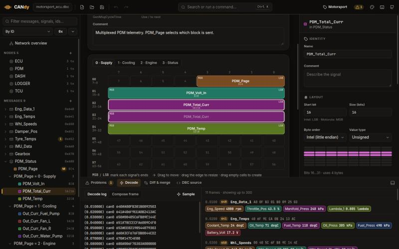

# 🍬 CANdy

> The sweetest CAN DBC editor. Fast, friendly and fully in your browser. Your files never leave your machine.

[](https://rephlexzero.github.io/candy/)
[](https://github.com/RephlexZero/candy/actions)
[](LICENSE)

**→ [Open CANdy](https://rephlexzero.github.io/candy/)**



---

## What it is

CANdy is an editor for [DBC files](https://www.csselectronics.com/pages/can-dbc-file-database-intro), the format used to describe CAN bus networks in cars, race cars, trucks, batteries and robots. It is written in Rust and compiled to WebAssembly, so it runs entirely in the browser: open a file, edit it, save it. Nothing is uploaded.

It aims to be the editor you actually enjoy using: you can see what every bit does, and it tells you when something is wrong and how to fix it.

## Features

| | |
|---|---|
| **Bit layout grid** | Every message drawn byte by byte. Drag a signal to move it, drag its edge to resize it, drag across empty bits to create one. Intel and Motorola, MSB/LSB marked, overlaps in red, arrow keys to nudge. |
| **Multiplexing** | Simple (`M`/`mN`), nested (`mNM`) and extended (`SG_MUL_VAL_`) multiplexing. Branch tabs on the grid, branch folders in the tree, and no false overlap warnings between branches that never coexist. |
| **Tree view** | Network → nodes → messages → mux branches → signals. Group by ID, sender, A–Z or your own nested folders (stored as a `CANdy_Group` attribute, so other tools keep them). Filter as you type. |
| **Naming conventions** | Presets for classic DBC, Vector/OEM (`Wheel_Speed_FL`), AUTOSAR short names, node-prefixed, SAE J1939, motorsport (`Group_Quantity_Location` with FL/FR/RL/RR corners), snake_case, camelCase and SCREAMING_SNAKE. Each name gets reasons and a suggested fix; the picker previews every rename before applying them in bulk. The choice is saved in the DBC. |
| **Lint & auto-fix** | 25 rules: duplicate ids and names, signals outside the payload, overlaps, invalid sizes, zero factors, unreachable or unset ranges, missing units, undeclared or unused nodes, mux problems, broken signal groups and more. Each one is explained in a hover card, and most can be fixed with a click or all at once. |
| **Hover cards** | Point at any signal, message, node or rule to see its bits, formula, range, value table, J1939 PGN/SA/priority, cycle time and comment. |
| **Inspector** | Scaling formula preview, raw ⇄ physical calculator, "fit range", value-description editor, receivers, attributes with type-aware editors. |
| **Decode playground** | Paste candump, Vector ASC, PCAN TRC or plain hex lines and see every frame decoded with labels and ranges. Or compose a frame from physical values and copy it as a candump line. |
| **Diff & merge** | Review changes since you opened the file and revert any of them, or compare with another DBC (Shift+drop it anywhere) and cherry-pick changes into yours. |
| **DBC source** | Syntax-highlighted live output, editable in place. Unknown sections are preserved verbatim, so nothing is lost on save. |
| **Everything else** | Undo/redo with labels, command palette (Ctrl K), keyboard shortcuts (?), autosave and session restore, drag-drop/paste/`?url=` loading, File System Access saving where supported, bus-load estimate, CAN FD lengths, eight colour schemes. |

### Colour schemes

Stone Light and Stone Dark (default, follows your OS), Midnight, Paddock, Phosphor, Solarized Light, Solarized Dark and High Contrast.

## Tech stack

| Layer | Technology |
|---|---|
| UI | [Leptos 0.8](https://leptos.dev/) (Rust → WASM, client-side rendering) |
| Build | [Trunk](https://trunkrs.dev/) |
| Styling | Hand-written CSS with design tokens, self-hosted Inter + JetBrains Mono |
| DBC engine | Pure Rust, no dependencies beyond `serde`: lossless error-tolerant parser, canonical writer, layout, decode, lint, naming, diff |
| Hosting | GitHub Pages via GitHub Actions |

```
candy/
├── crates/
│   ├── dbc/            # candy-dbc: the engine (no wasm deps, fully unit/property tested)
│   └── app/            # candy-app: Leptos UI
│       ├── src/components/   # tree, bit grid, inspector, dock, palette, modals…
│       ├── style.css         # design system and themes
│       └── fonts/
├── fixtures/           # example DBCs (also used by the tests)
└── .github/workflows/  # CI + Pages deploy
```

## Development

Requires Rust (stable), the `wasm32-unknown-unknown` target and [Trunk](https://trunkrs.dev/).

```bash
rustup target add wasm32-unknown-unknown
cargo install trunk
trunk serve            # http://localhost:8087/candy/
```

```bash
cargo test -p candy-dbc                                              # engine tests
cargo clippy -p candy-app --target wasm32-unknown-unknown -- -D warnings
trunk build --release                                                # output in dist/
```

## Licence

[MIT](LICENSE)
